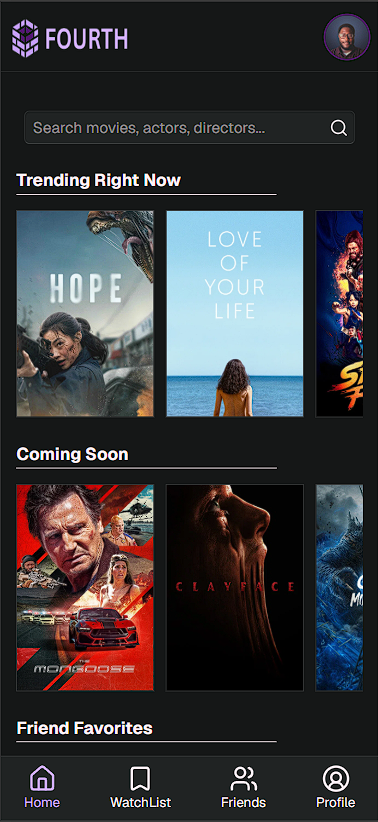
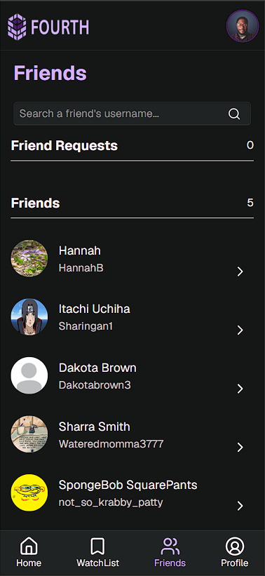
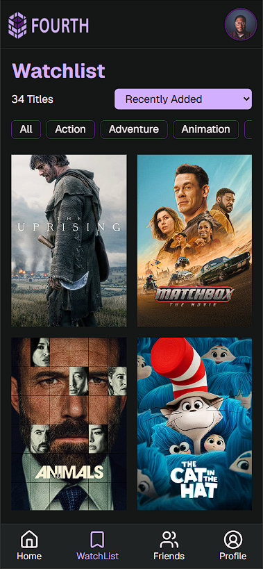
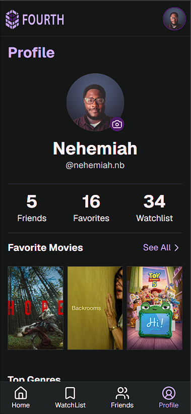
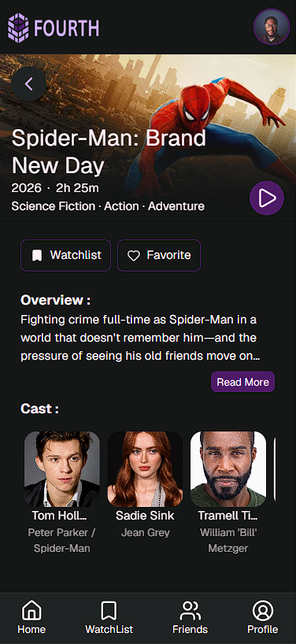

# Fourth

Fourth is a social PWA for movie lovers. Users can discover new movies, add movies to their personal watchlist, and favorite movies that they've enjoyed. They can also add friends, and view what movies their friends are watching. Fourth is about building the fourth wall as a community.

## Features

### Authentication

1. Fourth provides authentication. allowing users to log into personal accounts, and save data.

### Social

1. Users can send, accept, and decline friend requests.
2. On the Friends page users can search for friends by their username and view their profiles.

### Watchlist & Favorites

1. Users can add movies they plan to watch to their watchlist as a reminder for later viewing.
2. Users can add movies to their favorites list as a way to create their personal profile on fourth.

### Movie Discovery

1. Users can discover trending and upcoming movies as well as their friend's favorite movies on the Home page.
2. Users can click on movie posters throughout the app to view a detailed page on the clicked movie.
3. On the detailed page users can view the movie's trailer as well as click on cast member's pictures to view a quick bio.

- Profiles
  1. Users can change their profile picture on their profile page and view their favorite genres.

## Tech Stack

    - React.js
    - JavaScript
    - Vite
    - Tailwind CSS
    - Firebase
        - Authentication
        - Cloud Firestore
        - Storage
        - Hosting
    - TMDB API
    - Lucide React Icons

## Technical Challenges
### Building the friend system.
  - To build the friend system I had to implement batch writes so that I could update both the sender and receiver's subcollections. Batch writes ensure that either both subcollections are updated or neither is. That detail is very important when building a friend system. If User A sends a friend request to User B, I wouldn't want the request successfully documented in User A's collection but failed in User B's.

  I also had to write security rules that allowed users to create, read and delete friend requests from both the sender and receiver's subcollections. For all permitted operations, I required the user to be authorized. For example, User A can create and delete their outgoing request, while User B can read and decline their incoming request. I also had to allow User A to create the incoming request document for User B. In a future update, I will allow User A to cancel requests they've sent.

  I realized fairly quickly how important it was for the application to update in real time. As a result I implemented real-time updates on friend requests and friendships using Firestore's onSnapshot() method. Now users can see friend requests and changes to their friends list in real time without refreshing the app.

### Updating Firestore and React state.
  - Often times I had to update or retrieve data in a user's Firestore collection using getDoc, setDoc, updateDoc, etc. The problem with relying on Firestore to update the UI is that users can experience a delay when waiting for data to be saved or retrieved. To solve that problem I used Firestore methods to update data, and React state to update the UI without waiting for another database fetch.

  An example of where I implement this is with my watchlist. On my MovieDetailedView component users can add a movie to their watchlist by clicking a button. That button triggers two functions. One to add the movie to the user's watchlist collection, and another to add the movie to state. I use the state to update the user's watchlist page immediately.

## Live Demo

https://fourth-bc0b3.web.app/

## Screenshots

### Home Page

### Friends Page

### Watchlist Page

### Profile Page

### Movie Details Page

### Cast Details Page

## Future Improvements

### Watched Movies
  - Allow users to mark movies as watched.

### Movie Ratings
  - Create a ratings system where users can rate movies and see how their ratings stack up with their friends.

### Social Activity Feed
  - Users can make posts about movies for their friends to see.

